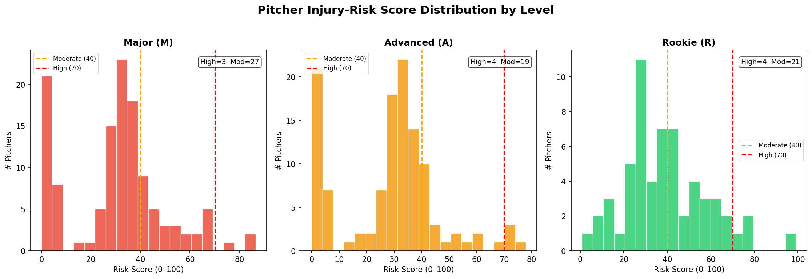

# Pitcher Injury Risk: SSAC Sport Med Hackathon 2026

Which pitchers are most at risk of injury going into the playoffs? A workload-based risk score (0–100) for every pitcher in a simulated baseball league, built for coaches and medical staff deciding who to rest. Team submission to the SSAC Sport Med Hackathon 2026.

**Live dashboard:** [Tableau Public](https://public.tableau.com/app/profile/piyush.sharda/viz/BaseballAnalyticsHackathonDashboard/LandingPage) · **Presentation:** [YouTube](https://youtu.be/ILpXDYBPQgY) · **Code:** this repo


<!-- TODO: optionally replace with a screenshot of the Tableau landing page (docs/screenshot-dashboard.png) -->

**Stack:** Python (pandas, NumPy, Matplotlib) · Tableau

## Method
Each pitcher's regular-season game logs are merged into one profile (deduplicated by name across IDs), and six workload signals are min-max scaled and weighted into a 0–100 score:

| Signal | Weight |
|---|---|
| Season volume (total pitches) | 20% |
| High-pitch outings (>80, >95 pitches) | 20% |
| Peak acute:chronic workload ratio (7-day vs 28-day) | 20% |
| Short-rest outings (<3, <4 days) | 15% |
| End-of-season load (last 7 and 14 days) | 15% |
| Peak single-outing load | 10% |

Labels: High 70–100, Moderate 40–69, Low 0–39. It is a rule-based score from sports-medicine workload guidelines, not a trained model, and it was not validated against the injury log.

## Key results
From `outputs/v2/pitcher_risk_summary.csv` (reproduced by `pitcher_injury_risk_v2.py`):

- **301 pitchers scored: 11 High, 67 Moderate, 223 Low.**
- High-risk by level: 3 Major, 4 Advanced, 4 Rookie.

## Run it locally

```bash
pip install pandas numpy matplotlib openpyxl
python3 pitcher_injury_risk_v2.py      # writes outputs/v2/
```

The game-log CSVs, `player_pitching.csv` and `injuries.csv` in the repo root are the hackathon's provided data.

## Team
Pranay Ratan, Piyush Sharda
